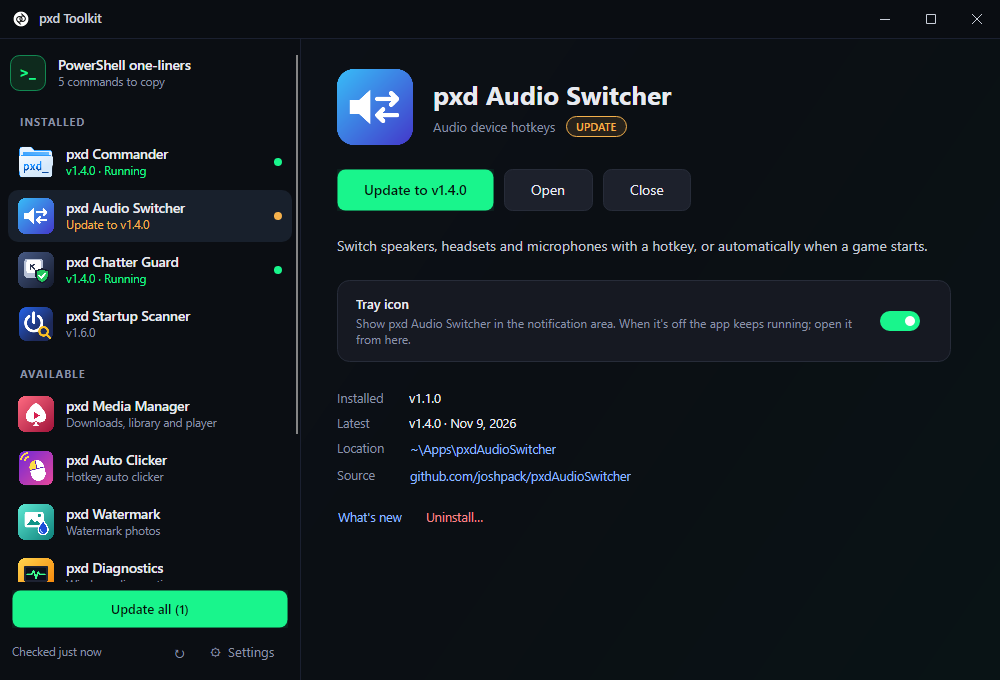

# PAX Toolkit

One app for all the PAX apps. PAX Toolkit lists every PAX app on GitHub, installs any of them with one click, keeps them up to date, lets you open, start or close them, and decides which of them show a tray icon.



## Features

- **Clean layout.** Installed apps and available apps in a slim sidebar (a green dot means running, an orange one means an update is waiting); the selected app gets one clear main button (Install, Update or Open) with the rest tucked below.
- **One-click install.** The toolkit downloads the app's latest release from GitHub, checks the SHA-256 checksum when the release has one, and installs it to `%USERPROFILE%\Apps\<App>`. Uninstall closes and removes it; its settings stay, so installing it again picks up where you left off.
- **Updates.** The toolkit checks GitHub every 6 hours (or when you click ↻), and updates apps one at a time or all at once. A running app is closed for the update and started again afterwards. You can let it install updates on its own.
- **Tray icons on or off.** Every PAX app with a tray icon has a *Tray icon* switch here. Off, the app keeps running without an icon; open it from the toolkit. The app's own settings have the same switch, and both stay in sync (the [PAX App Standard](docs/standard/PAX-APP-STANDARD.md)).
- **Its own tray icon.** Every installed app is in the tray menu: start it, start it in its own tray, close it, update it, or open its folder. A green dot on the icon means updates are waiting.
- **Finds what you already have.** Apps already in your Apps folder, or installed with their own setup, show up as installed.
- **PowerShell one-liners.** Apps that have one (like Startup Scanner) show their `irm … | iex` command with a Copy button, for PCs without the toolkit. The toolkit's own is under *Settings*.
- **.NET check.** If an app needs a .NET runtime you don't have, the toolkit says so and can install it with winget.
- **Start menu shortcuts** in *Start → PAX Toolkit* for each app (optional).
- **New apps show up by themselves.** The app list is `catalog.json` in this repo, which the toolkit reads at every check.
- **Updates itself** when a new PAX Toolkit release is out.

## Apps

| App | What it does |
| --- | --- |
| [PAX Commander](https://github.com/joshpack/PaxCommander) | Dual-pane file manager |
| [PAX Media Manager](https://github.com/joshpack/PaxMediaManager) | Download mover, poster library and player |
| [PAX Audio Switcher](https://github.com/joshpack/PaxAudioSwitcher) | Audio device hotkeys and profiles |
| [PAX Auto Clicker](https://github.com/joshpack/PaxAutoClicker) | Hotkey auto clicker |
| [PAX Chatter Guard](https://github.com/joshpack/PaxChatterGuard) | Keyboard and mouse chatter filter |
| [PAX Startup Scanner](https://github.com/joshpack/PaxStartupScanner) | Startup items and boot time (PowerShell, runs as admin) |
| [PAX Watermark](https://github.com/joshpack/pax_watermark) | Watermark one photo or a whole folder |
| [PAX Diagnostics](https://github.com/joshpack/Pax_Diagnostics) | System info, SFC/DISM repairs, CBS log filter |

## Supported systems

| OS | Status |
| --- | --- |
| Windows 10 / 11 (x64) | Supported |
| macOS, Linux | Not supported (the apps it installs are Windows builds) |

## Install

### One line in PowerShell

```powershell
irm paxdigi.com/toolkit | iex
```

No admin needed. It downloads the latest release, checks its SHA-256, puts `PaxToolkit.exe` in `%USERPROFILE%\Apps\PaxToolkit`, adds a Start menu shortcut (*Start → PAX Toolkit*) and starts it. Run it again to update. The short address forwards to [`install.ps1`](install.ps1) in this repo; the full address works too:

```powershell
irm https://raw.githubusercontent.com/joshpack/PaxToolkit/main/install.ps1 | iex
```

Options go in environment variables first, for example `$env:PAXTK_HOME = 'D:\Tools\PaxToolkit'; irm paxdigi.com/toolkit | iex` (also `PAXTK_NOSTART=1`, `PAXTK_NOSHORTCUT=1`).

### By hand

1. Download `PaxToolkit-<version>-win-x64.zip` from [Releases](https://github.com/joshpack/PaxToolkit/releases) and unzip it.
2. Run `PaxToolkit.exe`. It is a single self-contained file, so no .NET install is needed.
3. Click **Move it there** under **Settings** to keep it in `%USERPROFILE%\Apps\PaxToolkit` with a Start menu shortcut, and tick *Start PAX Toolkit with Windows* if you want the tray icon at sign-in.

## Command line

| Option | Does |
| --- | --- |
| `--minimized` | Start in the tray without opening the window |
| `--show` | Open the window (a second launch hands this to the running copy) |

## Build from source

```
dotnet build -c Release
dotnet publish -c Release -r win-x64 --self-contained true -p:PublishSingleFile=true -o publish
```

Needs the .NET 10 SDK. `--self-test <folder>` runs the engine against GitHub with the install paths pointed elsewhere (set `PAXTK_DATA`, `PAXTK_APPS` and `PAXTK_STARTMENU` first), installs and removes a small app, and renders the window off-screen.

## Adding an app

Add an entry to `catalog.json`: the GitHub repo, a regex for the release asset (`zip` or a PowerShell `script`), the file to start and its folder name. Optional: `installCommand` (a PowerShell one-liner shown with a Copy button), `tray` (the app follows the PAX App Standard tray link, so the toolkit shows its *Tray icon* switch), `openArgs`, `trayArgs` (shows *Start in tray*), `guiArgs`, `elevate`, `knownPaths` and `uninstall` for copies installed by their own setup. Put a 256 px PNG in `Assets/icons/<id>.png` for its picture, or it gets a tile with its initials.
